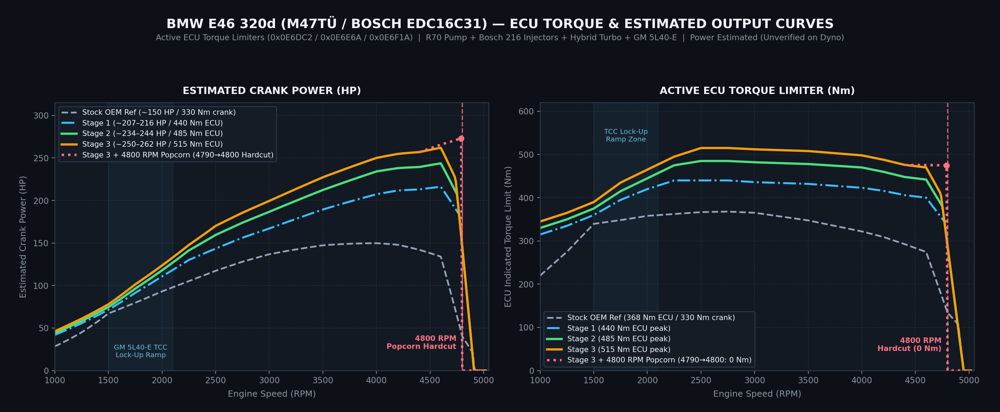
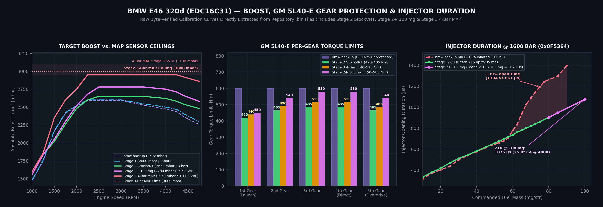

# BMW E46 320d (M47TÜ) — Bosch EDC16C31 (`SW 1037361858`) ECU Calibration, TunerPro XDF & Map Pack

**Vehicle / Engine:** BMW E46 320d 2.0d (`M47TÜ` / `M47D20O1`, 150 HP / 110 kW stock, 4-cyl 16V Common-Rail)  
**ECU:** Bosch **EDC16C31** (`DDE 5.0` / `DDE5`) — 1 MB Flash (`1,048,576` bytes, Big-Endian 16-bit)  
**Software / Calibration ID:** Bosch SW `1037361858` (`10373618581974842A`) | BMW Cal ID `O_U6K482` (`0001970048020KU60`)  
**Target Hardware Setup:**
- Bosch CP3 **R70** High-Pressure Fuel Pump (`0 445 010 070` / `0445010070`)
- Bosch **0 445 110 216** (`0445110216`) Upgrade Injectors *(replacing stock `0 445 110 131` / `0445110131`)*
- **Big-Wheel Vacuum-Actuated Hybrid Turbocharger** (Factory Stock VNT geometry + Stock `PCR_rGvnrMax` + Overboost PID & Hot-IAT fix)
- **GM 5L40-E** (`A5S390R`) 5-Speed Automatic Transmission (TCC lock-up & per-gear torque protection)
- **Stock 3-Bar MAP Sensor** (`0 281 002 437`, `3000 mbar` ceiling — Stage 2 / Stage 2+ 100 mg) **or BMW OEM 4-Bar MAP Sensor** (`13 62 7 792 260` / Bosch `0 281 002 997`, `4000 mbar` — Stage 3 4-Bar MAP + FMIC)
- Stock **1800-Bar Rail Pressure Sensor** (`1650 bar` operating ceiling)

---

## ECU Torque, Estimated Dyno Power & Calibration Charts

> **Note:** ECU Torque values (`Nm`) are read directly from the active ECU torque limiters (`min(0x0E6DC2, 0x0E6E6A, 0x0E6F1A, 0x0E0672)`). Crank Power (`HP`) is estimated using an M47TÜ friction loss baseline calibrated to the factory 150 HP @ 4000 RPM rating and has not been measured on a physical chassis dyno.

| Engine RPM | Stock OEM Ref (ECU Nm / Est. HP) | **Stage 2 StockVNT (ECU Nm / Est. HP)** | **Stage 2 StockVNT + Popcorn** | **Stage 2+ 100 mg StockVNT + Popcorn** | **Stage 3 4-Bar MAP + 4800 Popcorn** |
| :---: | :---: | :---: | :---: | :---: | :---: |
| **1000** | 220 Nm / 28.5 HP | **330 Nm / 44.1 HP** | **330 Nm / 44.1 HP** | **330 Nm / 44.1 HP** | **345 Nm / 46.3 HP** |
| **1500** | 340 Nm / 67.2 HP | **375 Nm / 74.7 HP** | **375 Nm / 74.7 HP** | **390 Nm / 78.0 HP** | **390 Nm / 78.0 HP** |
| **1750** | 348 Nm / 79.8 HP | **415 Nm / 96.4 HP** | **415 Nm / 96.4 HP** | **435 Nm / 101.4 HP** | **435 Nm / 101.4 HP** |
| **2000** | 358 Nm / 93.1 HP | **445 Nm / 117.9 HP** | **445 Nm / 117.9 HP** | **475 Nm / 126.4 HP** | **465 Nm / 123.6 HP** |
| **2250** | 362 Nm / 105.2 HP | **475 Nm / 141.3 HP** | **475 Nm / 141.3 HP** | **510 Nm / 152.5 HP** | **495 Nm / 147.7 HP** |
| **2500** | **367 Nm** / 117.4 HP | **485 Nm / 159.5 HP** | **485 Nm / 159.5 HP** | **535 Nm / 177.3 HP** | **515 Nm / 170.1 HP** |
| **3000** | 365 Nm / 136.8 HP | **482 Nm / 186.7 HP** | **482 Nm / 186.7 HP** | **545 Nm / 213.6 HP** | **512 Nm / 199.5 HP** |
| **3500** | 348 Nm / 147.3 HP | **478 Nm / 212.3 HP** | **478 Nm / 212.3 HP** | **580 Nm / 263.1 HP** | **508 Nm / 227.2 HP** |
| **4000** | 322 Nm / **149.8 HP** | **470 Nm / 234.1 HP** | **470 Nm / 234.1 HP** | **580 Nm / 296.7 HP*** | **498 Nm / 250.0 HP** |
| **4400** | 293 Nm / 142.0 HP | **448 Nm / 239.3 HP** | **448 Nm / 239.3 HP** | **570 Nm / 315.7 HP*** | **476 Nm / 256.9 HP** |
| **4600** | 274 Nm / 133.9 HP | **442 Nm / 243.6 HP** | **445 Nm / 245.6 HP** | **560 Nm / 320.9 HP*** | **475 Nm / 265.6 HP** |
| **4799** | 135 Nm / 40.7 HP | **290 Nm / 146.9 HP** | **442 Nm / 250.8 HP** | **550 Nm / 324.6 HP*** | **475 Nm / 273.3 HP** |
| **4800** | 134 Nm / 40.3 HP | **288 Nm / 145.6 HP** | **0 Nm (1-RPM Hardcut)** | **0 Nm (1-RPM Hardcut)** | **0 Nm (1-RPM Hardcut)** |
| **4950** | 0 Nm / 0.0 HP | **0 Nm / 0.0 HP** | **0 Nm / 0.0 HP** | **0 Nm / 0.0 HP** | **0 Nm / 0.0 HP** |

*\*Note: On `Stage2Plus_100mg`, torque limiter allows `580 Nm` (`100 mg/str`) across `3500–4200 RPM`, while MAF-based Smoke Lambda (`0.84–0.86` above `4400 RPM`) naturally tapers real injected fuel (`96 → 90 → 82 mg/str`) for turbine EGT protection (realistic peak crank output ~`275–290 HP`).*

### Boost Targets, GM 5L40-E Per-Gear Protection & Bosch 216 Injector Duration

---

## Documentation & Definition Files

| File | Description |
| :--- | :--- |
| [**`BMW_E46_320d_EDC16C31_1037361858.xdf`**](BMW_E46_320d_EDC16C31_1037361858.xdf) | **TunerPro XDF Map Definition File (49 Maps/Curves/Constants)** — Byte-verified for Bosch EDC16C31 SW `1037361858` (`O_U6K482`): Driver Wish, Torque Limiters, GM 5L40-E Gear Limits, NM2IQ, 216 Injector Duration, Boost, VNT Base 1–4, `PCR_rGvnrMax/Min`, PID `facP/I/D`, `PCR_rOutIMax`, MAP `BPSCD_pLin_CUR`, Rail, EGR & Swirl Flaps |
| [**`BMW_E46_EDC16C31_Analysis_and_Stage_Report.md`**](BMW_E46_EDC16C31_Analysis_and_Stage_Report.md) | Complete ECU analysis of `bmw backup.bin`, engineering notes for R70 + 216 + Hybrid + GM 5L40-E, **Stage 2 StockVNT**, **Stage 2+ 100 mg Performance Smoke**, **4-Bar MAP Stage 3 guide**, Binary Audit Bug Fixes, and full WinOLS / TunerPro map reference |

---

## Stage Calibration Overview

> **Note:** Power figures below are theoretical estimates and have not been dyno-verified.

| Calibration File | Est. Power / Torque | Fueling (IQ) | Target Boost (SVBL) | MAP Sensor | Lambda | Features / Status |
| :--- | :---: | :---: | :---: | :---: | :---: | :--- |
| **`BMW_E46_320d_R70_216_Hybrid_Stage2_StockVNT.bin`** | **~235 HP / 485 Nm** | **~80 mg/str** | **2650 mbar (2900)** | **Stock 3-Bar** | **0.93–1.06** | **Recommended Stage 2 (Daily / Smoke-Free):** Factory BMW OEM Stock VNT (`65.5→44.2%` low / `37.4→15.7%` high) + Stock `PCR_rGvnrMax`, Hot-IAT VNT bonus zeroed, Overboost PID (`PKpNeg +35% / IKiNeg +50%`), clean Swirl/SOI/Rail |
| **`BMW_E46_320d_R70_216_Hybrid_Stage2_StockVNT_Popcorn_4800RPM.bin`** | **~235 HP / 485 Nm** | **~80 mg/str** | **2650 mbar (2900)** | **Stock 3-Bar** | **0.93–1.06** | **Stage 2 StockVNT + 4800 RPM Popcorn:** Identical to `Stage2_StockVNT` + synchronized 1-RPM `4799 → 4800 RPM` Hardcut across all 6 torque limiters, 3 NM2IQ maps & Park/Neutral `0x0E93D4` |
| **`BMW_E46_320d_R70_216_Hybrid_Stage2Plus_100mg_StockVNT_Popcorn_4800RPM.bin`** | **~275–290 HP / 535→580 Nm** | **100.0 mg/str** | **2780 mbar (2950)** | **Stock 3-Bar** | **0.80–0.86** | **Stage 2+ 100 mg Performance Smoke (Stock 3-Bar MAP):** True `100 mg` Duration (`1075 µs` @ 1600 bar), `580 Nm` NM2IQ, `80/100 mg` SOI (`≤32.8°`), `105 mg` Hard IQ, GM 5L40-E gear protection (`450/540/580/580/540 Nm`), Factory Stock VNT + 4800 RPM P/N + Load Popcorn |
| **`BMW_E46_320d_R70_216_Hybrid_Stage3_4BarMAP_Popcorn_4800RPM.bin`** | **~260–275 HP / 515 Nm** | **~88–90 mg/str** | **2950 mbar (3100)** | **BMW 4-Bar MAP** | **0.92–1.03** | **Full Stage 3 (Requires 4-Bar MAP `13 62 7 792 260` + FMIC!):** True 4-bar `BPSCD_pLin_CUR`, Factory Stock VNT + Stock `PCR_rGvnrMax`, Hot-IAT/PID/Swirl/SOI/Rail fixes, crisp `4799 → 4800 RPM` 1-RPM Popcorn (P/N unlocked) |

---

## Repository Contents

### Root Calibration & Reference Binaries (`1,048,576` bytes each)

| File | MD5 Hash | Role / Notes |
| :--- | :--- | :--- |
| `BMW_E46_320d_R70_216_Hybrid_Stage2_StockVNT.bin` | `d0f2629c2e3a94692ab83c7ff8861d3e` | **Recommended Stage 2 (Stock 3-Bar MAP)** — Factory Stock VNT + Stock `PCR_rGvnrMax` + Hot-IAT/PID overboost control + Swirl/SOI/Rail audit fixes |
| `BMW_E46_320d_R70_216_Hybrid_Stage2_StockVNT_Popcorn_4800RPM.bin` | `26f2ab34c97154be8198ad140f0cea2e` | **Stage 2 StockVNT + 4800 RPM Popcorn** — Synchronized `4799 → 4800 RPM` 1-RPM Hardcut (including Park/Neutral `0x0E93D4` 4000 RPM standstill limiter unlocked to 4800 RPM) |
| `BMW_E46_320d_R70_216_Hybrid_Stage2Plus_100mg_StockVNT_Popcorn_4800RPM.bin` | `c1a90a4ccd7904661766ba34b395b3b5` | **Stage 2+ 100 mg + Performance Smoke (Stock 3-Bar MAP)** — `2780 mbar` / `2950 SVBL`, `100 mg` Duration (`1075 µs`), `580 Nm` NM2IQ, `λ = 0.80–0.86`, `80/100 mg` SOI, GM 5L40-E mid-range shaping (`535–545 Nm` → `580 Nm` @ 3500–4200 RPM), Factory Stock VNT, 4800 RPM P/N + Load Popcorn |
| `BMW_E46_320d_R70_216_Hybrid_Stage3_4BarMAP_Popcorn_4800RPM.bin` | `e51e7c04dfb2951bdf40c237b432abf4` | **Stage 3 (4-Bar MAP `13 62 7 792 260` + FMIC Required)** — 2950 mbar / 3100 SVBL / 515 Nm / Factory Stock VNT / 1-RPM 4800 Popcorn (P/N unlocked) |
| `bmw backup.bin` | `db288c01ac8fa701f72eb9444e85906a` | Original analyzed readout (Stage 1 + EGR Off + inflated 131 injector duration — **do not run with 216 injectors**) |
| `bmw_e46_Original SOI.bin` | `c11fbcf15ae1519b55cf4c066951248e` | Reference file with 216 injector Duration and stock SOI |

---

## Key Calibration Highlights

1. **True Bosch `0 445 110 216` Injector Duration (`0x0F5300 – 0x0F6D58`):** Replaces the +15% inflated `131` injector duration maps in `bmw backup.bin` (which over-fueled by ~39–40% on 216 injectors) with true 216 flow timing (`95 mg/str @ 1600 bar = 1032 µs`).
2. **GM 5L40-E Automatic Transmission Protection (`0x0E6D74`, `0x0E6E42`, `0x0E943A – 0x0E95D2`):** Activates per-gear torque limits (protecting 1st, 2nd, and 5th overdrive gears), enables TCC lock-up torque ramping between 1250–2000 RPM, and restores linear CAN-Bus NM2IQ torque reporting for the EGS.
3. **Clean Factory Stock VNT + Overboost Control (`Stage2_StockVNT.bin` & `Stage3_4BarMAP_Popcorn_4800RPM.bin`):**
   - **Stock OEM Low-RPM VNT (`0–2500 RPM`):** Restores factory BMW M47N `VNT1/4` (`80% → 65.5% → 55.5% → 49.5% → 44.2%`) and factory `PCR_rGvnrMax_MAP` (`85% → 78% → 68% → 62% → 56.7%`), eliminating launch/low-RPM overboost spikes and MAP fuel cut.
   - **Stock OEM High-RPM VNT2/3 Profile (`2750–4750 RPM`):** Uses BMW's smooth open-vane `37.4% → 35.4% → 29.0% → 27.0% → 23.4% → 20.1% → 15.7%` profile across all 4 maps (zero `-16%` cliff).
   - **Hot-IAT & Overboost PID Package:** Zeroed the hidden `+3.6%` hot-IAT VNT closing bonus (`PCR_facCtlIAT_CUR` @ `0x0F7EE2..0x0F7EE6`), sped up `PCR_rBPCtlBasDwn_C` (`50 → 80 %/s`), boosted overboost PID (`PKpNeg +35%`, `IKiNeg +50%`, `DKdNeg +30%`, `facP 7/5 → 10/9`, `facD 27/15 → 32/24`), and reshaped Target Boost (`2650 mbar` peak, tapered to `2480 mbar` @ 4750 RPM) to stop I-term windup.
4. **Full Binary Audit Bug Fixes (`Stage2_StockVNT` & `Stage3_4BarMAP`):** Fixed Swirl Flaps 2-byte overrun (`0x0E9EEC` & `0x0EA0EC`), SOI 1–5 2-byte boundary shift (`0x0EA80C..0x0EB31C`), and Rail Map 2 last-2-cell mislabel (`0x0FD060`/`0x0FD062` restored to `16485`).
5. **BMW OEM 4-Bar MAP Linearization (`Stage3_4BarMAP_Popcorn_4800RPM.bin`):** Full `BPSCD_pLin_CUR` (`0x0E384C`: `[63, 500, 4000, 4438] mbar`) and SRC thresholds (`31 / 985`) calibrated for OEM BMW `13 62 7 792 260` (Bosch `0 281 002 997`) + FMIC (`2950 mbar` target / `3100 mbar` SVBL).
6. **True `100 mg/str` Stage 2+ Performance Smoke Calibration (`Stage2Plus_100mg_StockVNT_Popcorn_4800RPM.bin`):** Extends all 6 Bosch 216 Duration maps to `100.0 mg` (`1075 µs` / `25.8° CA` @ 4000 RPM), extends NM2IQ 1–3 to `580 Nm` linearly, rescales SOI 1–5 (`80 / 100 mg`, `≤ 32.8°` for clean EOI), raises Hard IQ (`0x0E6F46`) to `105 mg`, bumps boost to `2780 mbar` (`2950 SVBL` on stock 3-bar MAP) keeping Factory Stock VNT intact, tunes `Smoke 1–2` (`λ = 0.80–0.83` full-load performance smoke, `0.84–0.86` top-end EGT guard), and shapes GM 5L40-E torque (`535–545 Nm` mid-range → full `580 Nm / 100 mg` @ `3500–4200 RPM` in 3rd/4th gears) with full P/N + Load 4800 RPM Popcorn (`0x0E93D4` unlocked).

---

## WinOLS / TunerPro Map Address Reference (`SW 1037361858` / `O_U6K482`)

| Category | Map / Function (Bosch DAMOS Name) | Data Address *(Header/Axis)* | Size | Format & Scaling |
| :--- | :--- | :--- | :---: | :--- |
| **Pedal** | Driver Wish 1 (`AccPed_trqEngLow_MAP`) | `0x0E0672` *(`0x0E063C`)* | 16x9 | 16-bit HiLo Signed, `× 0.1 = Nm` |
| **Pedal** | Driver Wish 2 (`AccPed_trqEngHigh_MAP`) | `0x0E08B6` *(`0x0E0880`)* | 16x9 | 16-bit HiLo Signed, `× 0.1 = Nm` |
| **Air / EGR** | EGR Base Map (`AirCtl_mDesBas_MAP`) | `0x0E13AE` *(`0x0E1372`)* | 12x16 | 16-bit HiLo, `× 0.1 = mg/str` |
| **Air / EGR** | EGR Hysteresis 1 & 2 (`AirCtl_qHiRgn_CUR` / `qLoRgn_CUR`) | `0x0E2A22`, `0x0E2B54` | 25x1 (x2) | 16-bit HiLo, `× 0.01 = mg/str` (`0 = EGR Off`) |
| **MAP Sensor** | MAP Linearization & SRC (`BPSCD_pLin_CUR`, `uSRCMin/Max`) | `0x0E384C` *(SRC: `0x0E3848/4A`)* | 4x1, 1x1 | 16-bit HiLo (`mbar` / ADC counts) |
| **Air / Flaps** | Swirl Flaps (`IndSys_rVSA_MAP`) | `0x0E9EEC` *(`0x0E9EA8`)* | 16x16 | 16-bit HiLo, `× 0.01 = %` |
| **Torque** | Torque Limiter 1 (`EngPrt_trqLim_CUR`) | `0x0E66DA` *(`0x0E66AE`)* | 21x1 | 16-bit HiLo, `× 0.1 = Nm` |
| **Torque / EGS** | AT TCC Lock-Up Gear Switch (`EngPrt_swtTrqGear_CUR`) | `0x0E6D86` *(`0x0E6D74`)* | 8x1 | 16-bit HiLo, `0 = Off, 1 = Active` |
| **Torque** | Main Torque Limiter 2 (`EngPrt_trqLim1_CUR`) | `0x0E6DC2` *(`0x0E6D96`)* | 21x1 | 16-bit HiLo, `× 0.1 = Nm` |
| **Torque** | Launch Torque Limiter 3 (`EngPrt_trqLimDA_CUR`) | `0x0E6E18` *(`0x0E6DEC`)* | 21x1 | 16-bit HiLo, `× 0.1 = Nm` |
| **Torque / EGS** | AT TCC Lock-Up Torque Limiter 4 (`EngPrt_trqCBLim_CUR`) | `0x0E6E6A` *(`0x0E6E42`)* | 19x1 | 16-bit HiLo, `× 0.1 = Nm` |
| **Torque** | Torque Limiter 5 (`EngPrt_trqCBLim1_CUR`) | `0x0E6EC4` *(`0x0E6E98`)* | 21x1 | 16-bit HiLo, `× 0.1 = Nm` |
| **Torque / Cut** | Rev Limiter / Normal Op. Torque Limit 6 (`EngPrt_trqNLim_CUR`) | `0x0E6F1A` *(`0x0E6EEE`)* | 21x1 | 16-bit HiLo, `× 0.1 = Nm` |
| **Hard IQ** | Overheat / Vmax Fuel Ceiling (`EngPrt_qOvhtPrvVRng_MAP`) | `0x0E6F84` *(`0x0E6F46`)* | 13x16 | 16-bit HiLo, `× 0.01 = mg/str` |
| **GM 5L40-E** | Park/Neutral Standstill Torque Limit (`Gearbx_trqInMax_CUR`) | `0x0E9408` *(`0x0E93D4`)* | 25x1 | 16-bit HiLo Signed, `× 0.1 = Nm` |
| **GM 5L40-E** | 1st–5th Gear Torque Limits (`Gearbx_trqMaxGear1..5_CUR`) | `0x0E945A`, `0x0E94C0`, `0x0E9526`, `0x0E958C`, `0x0E95F2` | 15x1 (x5) | 16-bit HiLo, `× 0.1 = Nm` |
| **Smoke** | Smoke / Lambda Maps 1 & 2 (`FlMng_rLmbdSmk_MAP` / `Smk2`) | `0x0E77D2`, `0x0E7A16` | 16x16 (x2) | 16-bit HiLo, `× 0.001 = Lambda` |
| **Conversion** | Torque → IQ Maps 1–3 (`FMTC_trq2qBas_MAP`) | `0x0E80EA`, `0x0E832E`, `0x0E8572` | 16x16 (x3) | 16-bit HiLo, `× 0.01 = mg/str` |
| **Timing (SOI)** | SOI Maps 1–5 (`InjCrv_phiMI1Bas1..5_MAP`) | `0x0EA80C`, `0x0EAA50`, `0x0EAC94`, `0x0EAED8`, `0x0EB11C` | 16x16 (x5) | 16-bit HiLo Signed, `× 0.0234375 = °CA` |
| **Duration** | Injector Duration Maps 1–6 (`InjVCD_tiET_MAP`) | `0x0F5364`, `0x0F57C8`, `0x0F5C2C`, `0x0F6090`, `0x0F64F4`, `0x0F6958` | 16x32 (x6) | 16-bit HiLo, `× 1.0 = µs` |
| **Turbo VNT** | VNT IAT Corr & Ramp (`PCR_facCtlIAT_CUR`, `rBPCtlBasDwn_C`) | `0x0F7EC6` (8x1), `0x0F7EFC` (u32) | 8x1, 1x1 | `÷ 8192 = factor` / `÷ 5368.71 = %/s` |
| **Turbo VNT** | VNT N75 Duty Cycle Maps 1–4 (`PCR_rCtlBas_MAP`) | `0x0F7F44`, `0x0F8478`, `0x0F86BC`, `0x0F8900` | 16x16 (x4) | 16-bit HiLo, `× 0.012207 = %` |
| **Turbo Boost** | Target Boost Maps 1–3 (`PCR_pDesBas_MAP`) | `0x0F9394`, `0x0F95D8`, `0x0F981C` | 16x16 (x3) | 16-bit HiLo, `× 1.0 = mbar` |
| **Turbo Limit** | Atmospheric Max Boost & SVBL (`PCR_pDesMaxAP_MAP` / `Max_C`) | `0x0F9A48` *(10x10)*, `0x0F9C60` *(1x1)* | 10x10, 1x1 | 16-bit HiLo, `× 1.0 = mbar` |
| **Turbo PID** | PID Factor Maps (`PCR_facD_MAP`, `facI_MAP`, `facP_MAP`) | `0x0F9E0A`, `0x0F9EA6`, `0x0FA186` | 10x6 (x3) | 16-bit HiLo, `÷ 128 = factor` |
| **Turbo PID** | PID Neg Gains (`PCR_DKdNeg_C`, `IKiNeg_C`, `PKpNeg_C`) | `0x0F9D58`, `0x0FA208`, `0x0FA218` | 32-bit (x3) | 32-bit HiLo (`Kd/Ki/Kp` overboost gains) |
| **Turbo VNT** | VNT Upper/Lower Ceilings (`PCR_rGvnrMax_MAP`, `rGvnrMin_MAP`) | `0x0FA3DC` *(16x16)*, `0x0FA5F0` *(4x4)* | 16x16, 4x4 | 16-bit HiLo, `× 0.012207 = %` |
| **Turbo Diag** | Overboost Deviation & Debounce (`PCR_pBGDevMin_C`, `DebSRCLow`) | `0x0FA6D2` *(s16)*, `0x0FA6C4` *(u16)* | 1x1 (x2) | 16-bit HiLo (`mbar` / ticks) |
| **Rail** | Rail Pressure Base Maps 1 & 2 (`Rail_pSetPointBase_MAP`) | `0x0FC9D0`, `0x0FCE64` | 16x16 (x2) | 16-bit HiLo, `× 0.1 = bar` |
| **Rail Limit** | Rail Max Table (`Rail_pSetPointMax_MAP`) | `0x0FD1DC` *(`0x0FD1B0`)* | 12x8 | 16-bit HiLo, `× 0.1 = bar` |

---

## Important Safety & Verification Notice

- **Checksum Verification Required:** Although the 32-bit block sum at `0x0FEFF8` is maintained, always verify and recalculate full EDC16C31 checksums using a dedicated flashing tool (e.g., KESS, MPPS, BDM100, or WinOLS checksum module) before writing any `.bin` file to an ECU.
- **Hardware Matching Warning:** Never flash `Stage3_4BarMAP_Popcorn_4800RPM.bin` onto a vehicle still equipped with the stock 3-bar MAP sensor or stock intercooler (observed IAT up to `90.7°C` on Stage 2 pulls); install the BMW OEM `13 62 7 792 260` 4-bar MAP sensor and an upgraded FMIC first.
- **Disclaimer:** All binaries and notes are provided for educational and research purposes only. Always perform live datalogging (boost, VNT %, IAT, rail pressure, IQ, EGT, and transmission slip) and use entirely at your own risk.

---

## Related ECU Calibration Projects

- [**Suzuki Grand Vitara 1.9 DDiS (F9Q / Bosch EDC16C3-10.25) — ECU Tuning Package**](https://github.com/AyemKaan/Suzuki-Grand-Vitara-1.9-DDiS-EDC16C3) — Stage 1+ calibrations, N75/VNT limp-mode fix, EGR/TVA delete, 4300 RPM hardcut popcorn, and dyno curves.
